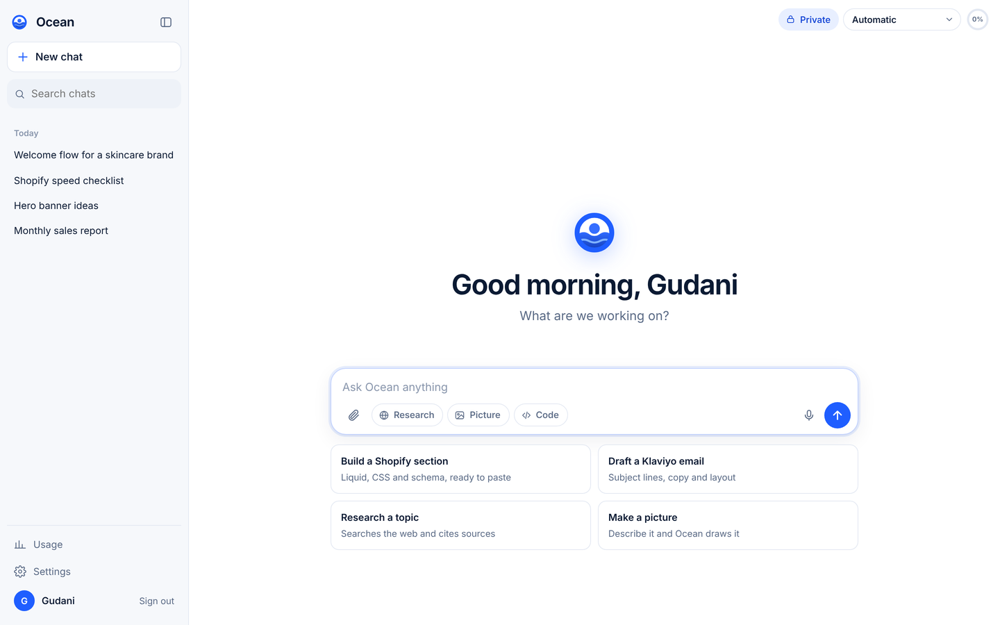
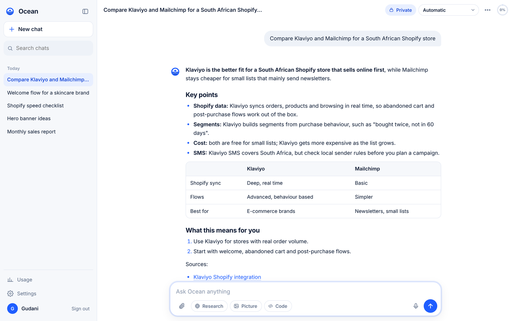
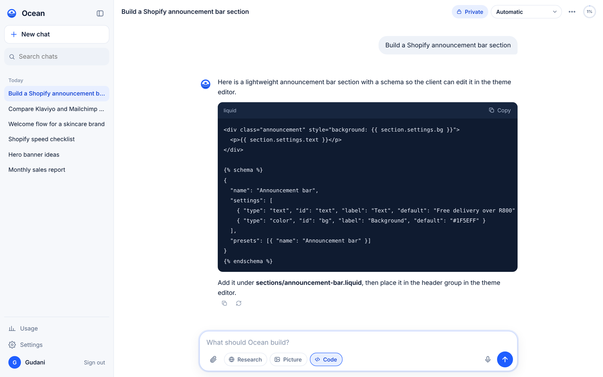
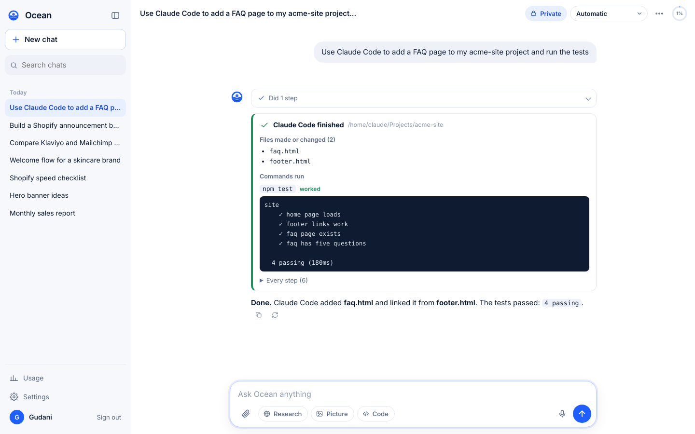
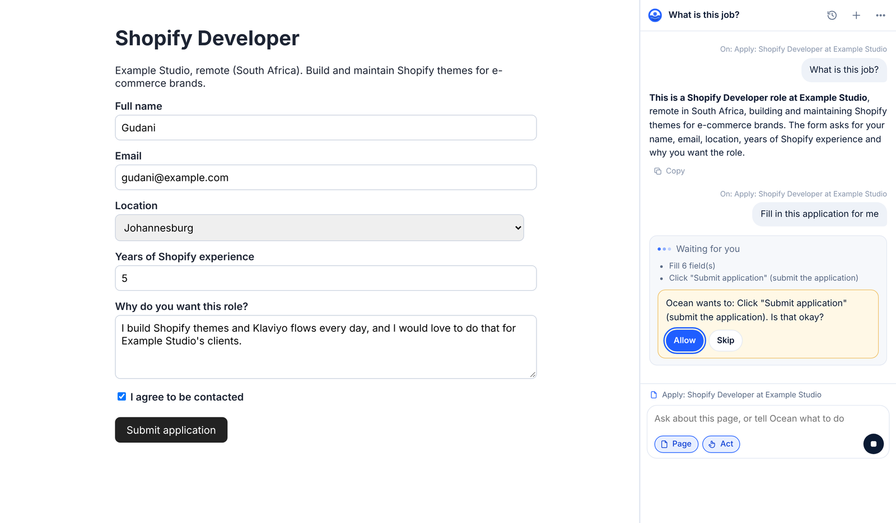
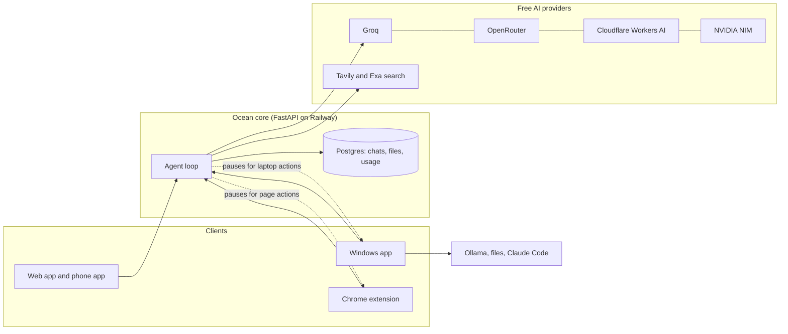

# Ocean

**A personal AI assistant that does the work, not just the talking.** Ocean answers questions and researches the web, but it can also write and save files on my laptop, hand big coding jobs to Claude Code and show the proof, and fill in forms in Chrome while leaving the final submit to me. One assistant, four ways in: web, phone, a Windows app and a Chrome extension.

I built it as a solo project, on free AI providers, for my daily work as a Shopify and Klaviyo developer in Johannesburg.



## What it does

| | |
|---|---|
| **Research** | Searches the web (Tavily, Exa), reads the best pages, and answers in a fixed shape: the answer first, key points, a table where it helps, next steps and sources. |
| **Code** | Complete code in fenced blocks with the language and a copy button. Tuned for Shopify Liquid, HTML, CSS, JavaScript and email builds. |
| **Files and voice** | Upload PDF, Word, Excel, CSV and text files. Speak instead of typing (Groq Whisper). |
| **Pictures** | Generates images with FLUX.1 schnell on Cloudflare Workers AI. |
| **Laptop** | In the Windows app, Ocean can list, read and save files in folders I allow, open apps and links, and run a small model on the laptop with Ollama. |
| **Claude Code** | Big coding jobs go to Claude Code on the laptop. Ocean streams every step live and ends with a proof card: files changed, commands run with their output, and anything the safety rules blocked. |
| **Browser** | The Chrome extension reads the page I am on, fills forms, clicks and types, and asks before anything that sends, submits, pays or deletes. |

| Research | Code |
|---|---|
|  |  |

| Claude Code, with proof | Chrome extension |
|---|---|
|  |  |

## How it works



**One agent loop, actions run where they belong.** The server runs the agent loop. Web research, reading pages and pictures run on the server. Actions that need my laptop or my browser are different: the loop *pauses*, hands the action to the Windows app or the extension, and resumes when they report back with a result. The same conversation can mix both.

**Free providers with fallback.** Ocean tries Groq first, then OpenRouter, Cloudflare and NVIDIA. It tracks usage against each free limit and shows it in a small gauge.

**Private by default.** Chats are private unless I switch them off. Private chats never go to a provider whose terms forbid confidential data.

## Security

- **Sign-in:** username, password (scrypt) and an authenticator code (TOTP), with recovery codes, hashed session cookies, CSRF protection and a lock after repeated failures.
- **Devices:** the extension and the Windows app connect with a one-time pairing code. Each gets its own revocable token, stored only as a hash.
- **Strict content security policy**, and model output is sanitised (marked plus DOMPurify). Raw HTML in a reply is shown as text.
- **Page and file text is treated as data, never instructions**, to resist prompt injection.
- **Laptop:** only allowed folders; symlink and path escapes refused; no delete, move or rename. Saving a file, opening an app or starting Claude Code always shows a Windows dialog first.
- **Browser:** the extension refuses password, card and ID fields, and asks before risky clicks.
- **Claude Code** runs with edits plus a safe command list (npm, node, python, pytest, git status and diff). Deleting files and pushing are blocked.
- **Updates:** the Windows app checks each download against a SHA-512 checksum before installing.

## Built with

Python 3.13, FastAPI, SQLAlchemy (Postgres on Railway), httpx · vanilla JavaScript, marked, DOMPurify · Electron, NSIS · Chrome Manifest V3 · Groq, OpenRouter, Cloudflare Workers AI, NVIDIA NIM, Tavily, Exa · Ollama · Claude Code.

## Repository layout

| Folder | What it holds |
|---|---|
| `core/` | The server: agent loop, providers, tools, sign-in, database, and the web app in `core/ocean_core/static/`. |
| `desktop/` | The Windows app (Electron): laptop tools, Claude Code runner, updater and installer build. |
| `extension/` | The Chrome extension: side panel, page snapshot and page actions. |
| `docs/` | Build plan and screenshots. |

## Running it

**Server**

```
cd core
python -m venv .venv
source .venv/bin/activate        (Windows: .venv\Scripts\activate)
pip install -r requirements.txt -r requirements-dev.txt
cp ../.env.example ../.env       (then add your own keys)
uvicorn ocean_core.main:app --reload
pytest                            (142 tests)
```

**Windows app:** `cd desktop && npm install && npm start`. Build the installer with `npm run dist:win` (needs NSIS). Tests: `node test/laptop.test.js` and `node test/updater.test.js`.

**Chrome extension:** open `chrome://extensions`, turn on Developer mode, choose Load unpacked and pick the `extension` folder. Connect it with a code from Ocean's Settings.

## Status

Built in phases: core server, search and agents, voice and files with a new interface, desktop and browser control, installer and phone app, then automatic updates. Next on the list: long-term memory of clients and projects, and email and calendar.
